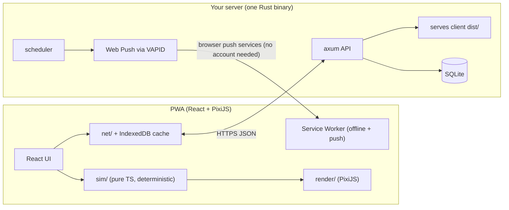

# Plan v3: "The Siege", 2D rebuild (`/v2`)

> **Note (2026-11-07):** the rebuild is complete; the old version was removed and the contents of `v2/` now live at the repository root. Paths below that start with `v2/` refer to the root.

This plan is split into four documents:
| Doc | Contents | Who reads it |
|---|---|---|
| **this file** | Concept, architecture, milestones | you |
| [design.md](design.md) | Complete rules and starting numbers | you, me, the other LLM |
| [art-list.md](art-list.md) | Every artwork, with a prompt and specs | **you** (you can start right away) |
| [tasks.md](tasks.md) | Task breakdown with files and acceptance criteria. Each task is marked **[S]** (strong model) or **[B]** (basic LLM) | implementers |

---

## 1. Concept: async co-op base defense on a painted battlefield

The look is StarCraft 1 / Kingdom Rush: a **scrollable, zoomable painted valley**. The team's **Keep** sits in the middle, roads lead in from the edges, each player owns a **sector** of build pads, and enemy hordes march in every Dawn.

The loop follows Thronefall's day/night rhythm: **day = build, Dawn = battle**.

| Daily step | Time | What happens |
|---|---|---|
| 1. Check in | 10 s | Your habit report earns **gold**. An honest miss still earns some. |
| 2. Scout | 10 s | Tomorrow's attack is shown on the map: which roads, and which enemy types (armoured, flying, siege…). |
| 3. Build | 30–60 s | Tap your pads to build or upgrade **Archer, Mage, Barracks or Catapult**, repair damage, set your **hero's** stance, or donate gold to teammates or the Keep. |
| 4. Watch Dawn | 20–40 s | A deterministic battle replay at 1×/2×/4×, with an auto-camera on your sector, then the stars and a short report. |

**What fixes the old version's problems:**
- **Real decisions.** Enemy types counter specific towers (armour beats arrows, flyers ignore soldiers), and you know tomorrow's wave in advance.
- **Persistent, visible progress.** Your towers grow over three levels, damage stays until you repair it, and the Keep grows as the team donates. On day 30 the valley looks completely different from day 1.
- **You are visible on the map.** Your hero is your avatar, and checking in or missing changes it (*Inspired* / *Weary*). Your banner marks your sector.
- **Co-op.** You can send your hero to reinforce a neighbour, donate gold to them, fund the Keep together, and everyone gets a *Rally* bonus when the whole team checks in.

### Why this works with still images only
- The camera is a ¾ top-down view. Units are **one image facing right**, mirrored in code for left.
- All motion is code: walking bob and squash, attack lunges, hit-flash, death fades, flying hover, building "pop", recoil.
- Projectiles, particles, smoke and fire on damaged buildings, shadows, health bars and damage numbers are all drawn in code.
- Building damage is a code overlay (smoke, fire, darkening). Only the destroyed state needs a rubble image.
- The map is one large painted image. A **map editor dev tool** lets you click in the paths and pads afterwards, so the image never has to match exact coordinates.
- **You only make still images.** About **60 images** cover the full first version (see art_list.md).

## 2. Architecture



### Key decisions
1. **The server stores data and enforces deadlines. It does not run the game.**
   - The server stores an append-only log per challenge: check-ins and orders per player and day. It rejects writes after that day's Dawn.
   - Every client replays the whole season from that log with the **same deterministic TS sim** (event sourcing). Same inputs give the same valley, the same battles and the same results on every phone.
   - Illegal orders, such as spending gold you don't have, are ignored deterministically by the sim, so the server never needs game logic.
   - Clients upload a hash of each day's resulting state. A mismatch shows a "desync" warning, which helps catch bugs.
2. **Determinism rules for `sim/`:**
   - No `Math.sin/cos/atan2/pow/exp/log`. Only `+ - * / Math.sqrt Math.floor Math.min Math.max`.
   - Seeded integer PRNG.
   - Stable iteration order: arrays sorted by id.
   - No `Date`, no `Math.random`, no DOM.
   - Each challenge records the `simVersion` it uses.
3. **Push notifications without an external account.** Web Push with **VAPID** keys generated on your server (Rust crate `web-push`). Delivery goes through the browsers' own push services, but there's no sign-up and no API key. On iOS, push only works when the PWA is installed to the home screen (iOS 16.4+).
4. **Accounts without email.** A device token is created on first launch. To use another device, a 6-character **transfer code** (valid 10 minutes) logs it in. Invite links like `/join/ABC123` add players to a challenge.
5. **One origin.** The Rust binary serves `/api/*` and the built client. Your existing reverse proxy (Caddy or nginx) handles HTTPS.
6. **Development without the server.** A `LocalBackend` (IndexedDB) implements the same interface. The vertical slice is fully playable offline, with fake teammates driven by a bot.

## 3. Repo layout (new folder; the old code stays untouched)

```
v2/
  docs/            design.md, art-list.md, api.md, tasks.md (copied from these artifacts)
  art/
    raw/           ← you drop generated PNGs here, named <id>.png
    manifest.json  ← id → type, target size, anchor, key colour
  tools/
    process-art.mjs    raw PNG → background removed, trimmed, resized → client/public/assets/*.webp
  client/          Vite + React + TS + PixiJS v8 + vite-plugin-pwa
    src/sim/       pure deterministic game logic + vitest tests
    src/content/   stats tables, map JSON (from editor), theme definitions
    src/render/    PixiJS scene, sprites, procedural animation, VFX, replay player
    src/ui/        React screens and sheets
    src/net/       Backend interface, HttpBackend, LocalBackend, sync
    src/dev/       map editor, battle sandbox, asset gallery (dev-only routes)
  server/          Rust: axum + rusqlite + web-push + chrono-tz
```

## 4. Milestones

| M | Goal | Done when |
|---|---|---|
| **M1** | Sim core and sandbox, placeholder graphics | A battle runs headless and in the sandbox with coloured placeholder shapes. Determinism tests pass. |
| **M2** | Art pipeline and style lock | You've delivered the 5 style-anchor images. `process-art` turns them into game sprites, and the asset gallery shows them. |
| **M3** | Local vertical slice | A full 7-day season plays on your phone offline (LocalBackend plus 2 bot teammates), with real art for the slice assets. **Main gate: is it fun and pretty?** |
| **M4** | Rust server | API, SQLite and deadline enforcement are running on your server. Integration tests pass. |
| **M5** | Multiplayer client | Invite links, sync, transfer code, desync check. Three real people play for a week. |
| **M6** | Push and PWA | Install flow, offline caching, reminders and Dawn notifications. |
| **M7** | Content and polish | All art, more Force themes, audio, balancing pass. |

M1 and the art work (M2) can run **in parallel**: you generate images while the sim gets built.

## 5. What happens to the old code
Nothing. `/v2` is independent. Possible reuse: the check-in ratio math (re-implemented in `v2/client/src/sim/economy.ts` per game_design.md §3) and the PRNG idea. After M5, the old code can be deleted whenever you like.

## 6. Open points (I'll go with my defaults unless you object)
- **Team size 2–8** for v1. Bigger teams need a bigger map and come later.
- **Title** stays "The Siege" for now.
- **Audio:** CC0 sound packs (e.g. Kenney), downloaded once and self-hosted. No service involved.
- **Fonts:** self-hosted OFL fonts ("Cinzel" for headings, "Nunito" for body text).
